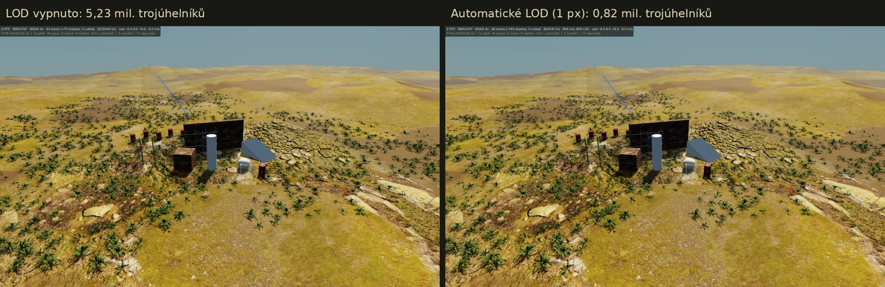
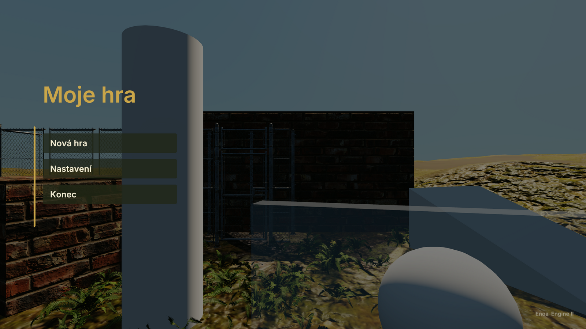
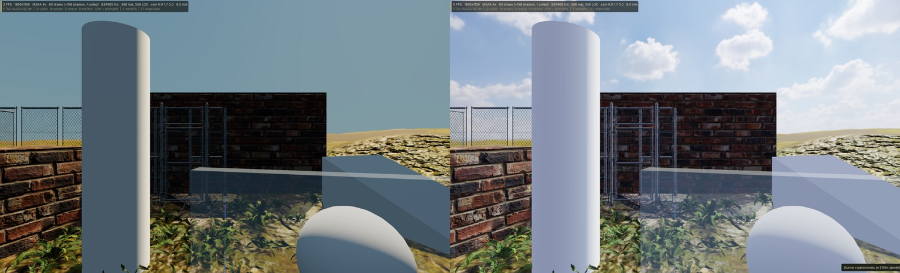

# Enoa-Engine II

**A proprietary C++17 3D game engine and editor by EnoaSoft.**  
**Independent technology for tactical FPS development — under active development.**

> **Public information repository.** This repository documents the project and provides selected development images. The engine source code, game source, build tools, binaries and private assets are **not published here**.

[Website](https://enoasoft.cz) · [Česky](docs/README_CS.md) · [Development status](docs/STATUS.md) · [FAQ](docs/FAQ.md)

## Overview

Enoa-Engine II is EnoaSoft's in-house technology project for building 3D interactive worlds and, ultimately, standalone games. It has its own Windows editor and renderer based on **Direct3D 11**. The project focuses on environment authoring, gameplay systems, visual fidelity, and efficient rendering of detailed scenes.

The technology is being developed alongside **Silent Patrol: Vietnam**, a tactical first-person game set during the Vietnam War. **Silent Patrol: Vietnam is one game with two parallel technical implementations**: an Unreal Engine 5 implementation for active game development and testing, and an implementation based on Enoa-Engine II. The long-term goal is to reduce dependence on third-party game engines.

## Technology currently present in development builds

| Area | Current scope |
| --- | --- |
| Engine & editor | C++17 core, Windows scene editor, Direct3D 11 renderer, scene hierarchy, inspector and tools |
| Rendering | PBR materials, dynamic shadows, fog/atmosphere, parallax material support, automatic model/foliage LOD |
| World building | Terrain sculpting and painting, vegetation placement, GLB/glTF asset import, Blender workflow, Poly Haven asset browser |
| Interactive systems | First-person controller, collision handling, Lua scripting, navigation and AI perception systems |
| Game presentation | Audio, menus, camera paths, cutscenes and an in-editor game build/export workflow |

These describe features visible in development material and project documentation, **not a claim of production readiness or completed end-to-end validation**. See [development status](docs/STATUS.md).

## Development images

| LOD comparison | Standalone game UI |
| --- | --- |
|  |  |

*These are screenshots from iterative development builds tested through Wine. Frame-rate indicators and similar overlays are not representative native-Windows performance benchmarks. The visuals, test scenes and UI are subject to change.*

## Availability and licensing

- **Stage:** active research and development; no public SDK, engine source release or public release date is announced here.
- **Source code:** private, proprietary.
- **Downloads:** none distributed through this repository.
- **Images:** supplied for project presentation; do not redistribute or reuse without permission from the rights holder.
- **Contributions:** this is an information-only repository. Public issues are not a commitment to accept code contributions to the private engine.

This repository deliberately **does not contain a permissive open-source license**. Its existence does not authorize use, modification or redistribution of Enoa-Engine II source code or media. See [NOTICE](NOTICE.md).

## Related project

**Silent Patrol: Vietnam** — an in-development tactical FPS using Enoa-Engine II as its long-term independent technology path. The game and engine are distinct projects; the engine repository is not a game source repository.

---

**EnoaSoft** · [enoasoft.cz](https://enoasoft.cz)  
*Project information and images: development snapshot, November 2026.*
