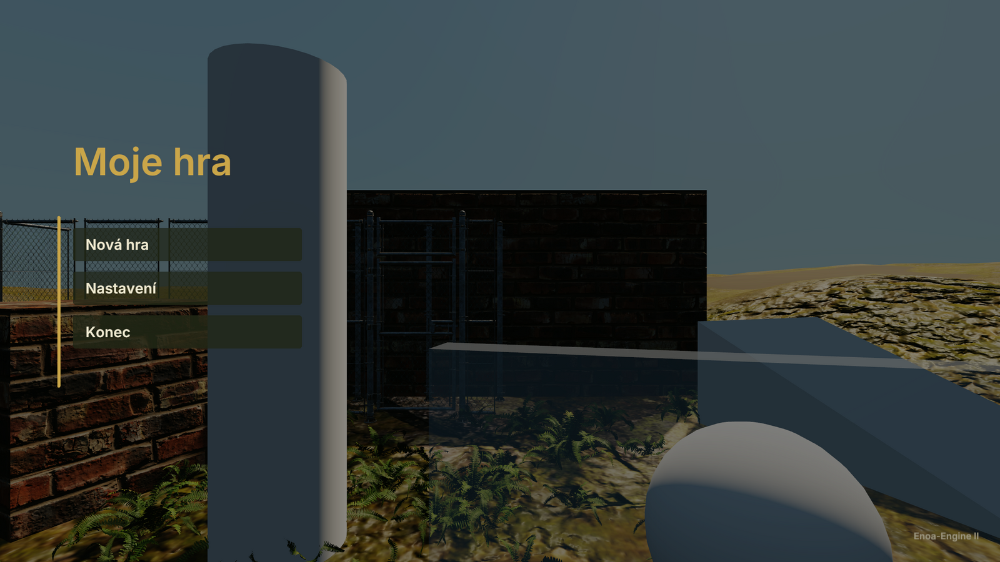

# Gameplay, Menus & Game Export

Enoa-Engine II is being developed beyond scene authoring, with systems needed to run a first-person game.

## Systems in development

- First-person movement and scene collision.
- Lua gameplay scripts and triggers.
- Navigation/pathfinding and perception for AI prototypes.
- Audio and positional sound.
- Camera animation and cutscenes.
- Game-menu UI including title/settings/pause flows.

These are **development features**; their presence does not imply a finished game or complete production gameplay stack.

## Game packaging

The development editor has shown a **Build Game** dialog that packages a project into a game executable with its data. A screenshot also demonstrates an in-game title menu.

The team reports that the exported executable was tested successfully in its development environment. Independent clean-system and native Windows compatibility checks are not asserted here.

**No game download is published** by this information repository.
