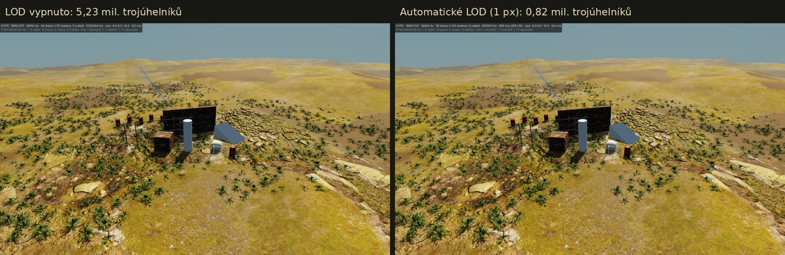
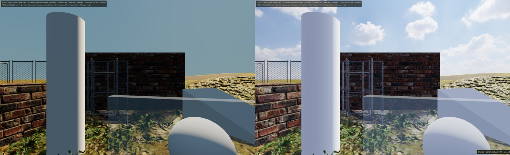

# Rendering, Materials & LOD

Enoa-Engine II uses a **Direct3D 11 rendering path** and includes development work around real-time materials, scene lighting, visual atmosphere and geometry optimization.

## Publicly described capabilities

- PBR metallic/roughness-style materials and texture maps.
- Shadows and atmospheric lighting / fog.
- Parallax material effect to increase perceived surface depth.
- Automatic level-of-detail (LOD) generation/selection for supported models and foliage.
- Scene/material editing inside the engine editor.

## Demonstration: automatic LOD

The example shows **5.23 million triangles with LOD disabled** versus **0.82 million with automatic LOD (1 px)**. This represents approximately **84% fewer triangles in that example**, **not** a verified equivalent FPS improvement.

## Demonstration: sky & atmosphere

Both are development comparisons, not final renders or cross-hardware benchmarks.

## Important qualification

The published screenshots were captured through **Wine**, so overlay FPS counters do not establish native Windows performance. Production rendering quality, GPU compatibility and frame-time performance require reproducible validation on target hardware.
