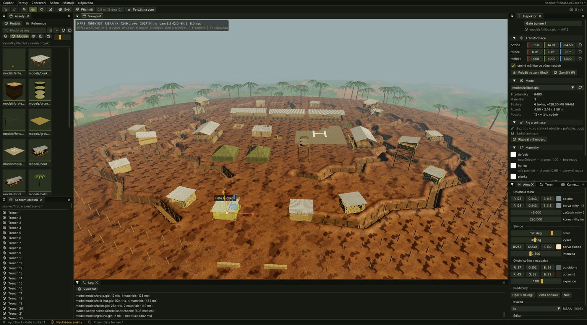

# Terrain, Vegetation & Assets

The editor includes workflows for building and populating 3D game environments.

## Terrain

Development screenshots show generated terrain, material-layer blending, terrain painting/sculpting controls and editable atmosphere parameters. The environment evolves over time: **early screenshots have sparse/flat worlds; newer screenshots show increased vegetation and materials**.

## Vegetation & world composition

Development materials show hand/brush-placed foliage, trees and props, as well as test scenes with built structures, trenches and environmental objects. Automatic LOD is used to help reduce scene geometry load.

## Asset pipeline

- **glTF/GLB:** a model import path intended for Blender exports.
- **Blender:** connected modeling and animation workflow.
- **Poly Haven:** asset-library browsing and import in the editor.
- **Materials:** PBR map inputs and parallax effects in material previews.

### Development images

**Asset policy:** Test scenes and source assets shown in public media are not automatically licensed for reuse or marked as final shipping assets. The public repository is for information only; see [NOTICE](https://github.com/EnoaSoft-s-r-o/enoa-engine-II-public/blob/main/NOTICE.md).

See [[Rendering-and-LOD]].
